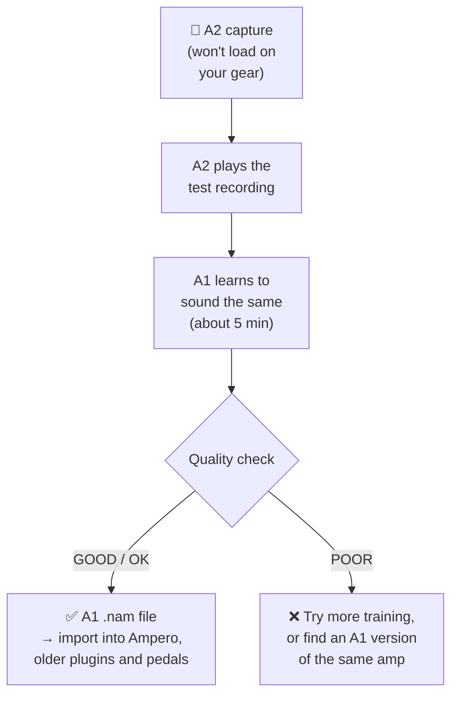

# nam-a2-to-a1

**Found a great amp capture on TONE3000, but your pedal or plugin won't load it?** This tool fixes that.

## In plain words

NAM amp captures (`.nam` files) now come in a new format called **A2**. A2 sounds great, but older gear only understands the previous format, **A1**. A 1st-gen Hotone Ampero, for example, just freezes when you try to import an A2 file.

You can't simply "save as" A1, because the two formats are built differently. So this tool takes the long way round, like a cover band learning a song by ear:

1. The **A2 capture plays** a recording of guitar parts, noise and sweeps through the virtual amp.
2. A fresh **A1 capture listens and copies** it, practising thousands of times until it sounds the same.
3. The tool **checks the result** and tells you plainly whether it's **GOOD**, **OK** or **POOR**.
4. You get a normal A1 `.nam` file that your old gear can load.



**Want to know first whether it's worth it?** `--predict` tells you in a few seconds whether a capture will probably convert well. Most captures convert fine. Some very complex ones don't, and the tool tells you so rather than handing you a bad file.

**No computer setup?** Use the [Google Colab version](#run-in-the-browser-google-colab), which runs in your web browser.

---

Technically: this tool converts [Neural Amp Modeler](https://github.com/sdatkinson/neural-amp-modeler) **A2** captures into **A1-standard** `.nam` files by distillation. It was built for the 1st-generation **Hotone Ampero**. Its editor (V1.5.0) hangs when importing an A2 file, but A1 files converted with this tool import and play fine.

## How it works

NAM A2 files use a new container format (`SlimmableContainer`, model version 0.7) and new layer types. Older loaders can't read them. This tool doesn't translate the file. It *re-trains* an A1 model to sound like the A2 model, a process called distillation:

1. **Render the teacher.** A training signal is played through the A2 model's full-size submodel at three input levels. This uses `neural-amp-modeler` 0.13, which reads A2.
2. **Train the student.** An A1-standard WaveNet learns to reproduce the A2 output. This uses `neural-amp-modeler` 0.11, which writes A1 files in model version 0.5.4. The training material is the training signal at three levels plus synthetic pink noise and sine sweeps.
3. **Check the result.** The tool measures the error (ESR) against the A2 original on two signals: the training signal, and a test signal the model never saw during training. It then prints a verdict:

| Verdict | ESR | Meaning |
|---|---|---|
| GOOD | ≤ 0.02 | Close match to the A2 original |
| OK | ≤ 0.05 | Small audible differences possible |
| POOR | > 0.05 | Conversion failed. The file is renamed `… POOR - do not use.nam`, and the tool exits with code 2 |

The tool needs two NAM versions because 0.13 can't load A1 configs and 0.11 can't load A2.

## Check before converting

Each A2 file contains a small *Lite* and a large *Full* version of the same capture. If even Lite sounds close to Full, the capture is simple enough for A1-standard and will most likely convert well. `--predict` measures this in a few seconds per file, without any training:

```bash
./nam-a2-to-a1 --predict *.nam
```

| Lite-vs-Full ESR | Prediction |
|---|---|
| ≤ 0.06 | LIKELY GOOD/OK. Convert with the default steps |
| 0.06–0.15 | UNCERTAIN. Try `--steps 1500` first |
| > 0.15 | LIKELY POOR. Look for an A1 version instead |

The thresholds are based on only a few captures so far:

| Capture | Lite-vs-Full ESR | Conversion result |
|---|---|---|
| 5150-style high gain | 0.026 | GOOD |
| Orange OR30 | 0.030 | OK |
| Orange Rockerverb | 0.35–0.51 | POOR |

Treat the prediction as an estimate, not a guarantee. When a capture comes in several variants (e.g. L/M/R mic positions), convert the one with the lowest score.

## How long it takes

Training runs a **fixed number of steps: 6000 by default**. That is enough for most captures. Captures that are hard to convert come out POOR. For those, override the step count with `--steps`, for example `--steps 20000`. Time grows linearly with the step count.

| Machine | 6000 steps (default) | 20000 steps |
|---|---|---|
| Apple M5 Pro (measured) | ~5 min | ~17 min |
| Apple M1 / M2 base (estimate) | ~15–20 min | ~1 h |
| NVIDIA GPU, incl. Colab T4 (estimate) | ~5–10 min | ~20–30 min |
| CPU only, e.g. Intel Mac (estimate) | 1–2 h | several hours |

Results so far:
- A 5150-style high-gain amp+cab capture: ESR 0.018 (GOOD) with the default 6000 steps.
- An Orange OR30 capture: ESR 0.009 on the training signal and 0.026 on the unseen test signal (OK) with 6000 steps.
- An Orange Rockerverb full-rig capture, whose own A2-Lite already differed a lot from A2-full: ESR 0.12 after 6000 steps and 0.09 after 20000 steps (POOR). It stopped improving. **Not every A2 capture can be converted accurately.** A1-standard is simply too small for some of them.

If you only want a quick check, `--steps 1500` takes about a quarter of the time and usually shows whether a capture converts well.

## Run in the browser (Google Colab)

No installation needed, and it uses Google's free GPU:

[](https://colab.research.google.com/github/jiivari/nam-a2-to-a1/blob/main/nam_a2_to_a1_colab.ipynb)

1. Choose **Runtime → Change runtime type → T4 GPU**.
2. Choose **Runtime → Run all**.
3. Upload your A2 file(s) and, optionally, a training signal.

The converted files download automatically when training finishes. You can change the step count in the first cell. Uploaded files are processed on Google's servers.

## Setup (local)

Requirements: Python 3.10+ and about 2 GB of disk space for two PyTorch environments.

```bash
git clone https://github.com/jiivari/nam-a2-to-a1.git
cd nam-a2-to-a1
./setup.sh
```

## Usage

```bash
./nam-a2-to-a1 --outdir converted "My Amp A2.nam"
```

| Option | Default | Description |
|---|---|---|
| `--input WAV` | the Ampero Editor's test signal (macOS), else synthetic | Training signal (any sample rate, at least 10 s) |
| `--outdir DIR` | `.` | Where the converted `… (A1).nam` files go |
| `--steps N` | 6000 | Training steps. Raise this if the result is POOR |
| `--template A1.nam` | random init | Warm-start from an existing A1-standard capture |
| `--predict` | | Don't convert. Only estimate how well each file would convert (see above) |

### Training signal

**Ampero users on macOS** usually don't need to pass anything. When the Ampero Editor imports a NAM file, it creates a test signal at
`~/Library/Application Support/com.hotone.mp380/wavs/nam_input_wav.wav`, and the tool uses that file by default. On our Mac the editor created the file at the first NAM import and left it unchanged after later imports.

- **If the file doesn't exist yet**, import any A1 `.nam` into the Ampero Editor once. That should create it, although we haven't confirmed this on a fresh install. Or simply run without it: the tool then falls back to a synthetic signal.
- **Is it better than the synthetic signal?** Probably, slightly, because it's a guitar-oriented test signal. We haven't confirmed whether the editor still uses this exact file when it builds the Ampero's own model. The synthetic fallback also gave OK results in testing.

Everyone else: pass `--input` with a varied guitar or DI signal of at least 10 s. NAM's standard training input works well. Without `--input`, a synthetic signal (pink noise and sine sweeps) is used. That works, but the result may be less accurate on real playing. This repository doesn't ship any audio.

## Using with Claude Code

The repo includes a [Claude Code](https://claude.com/claude-code) skill in `.claude/skills/nam-a2-to-a1/`. Start `claude` inside the cloned repo and ask in plain language, for example *"convert this capture to A1: ~/Downloads/My Amp.nam"* or *"my Ampero editor hangs when importing this .nam"*. Claude then:
- checks whether each file is A1 or A2,
- sets up the environments if needed,
- picks the training signal,
- runs the conversion,
- interprets the GOOD/OK/POOR verdict and retries with more steps when it makes sense.

To use the skill from any folder, copy or symlink it into `~/.claude/skills/`. The skill expects the repo next to it, so adjust the paths if you move it.

To check a file by hand:

```bash
python3 .claude/skills/nam-a2-to-a1/scripts/inspect_nam.py --predict "My Amp.nam"
```

## Notes

- Some accuracy is lost, because A1-standard is a smaller network than A2-full. If the capture's author also publishes an A1 version, use that instead.
- The Ampero doesn't run NAM itself. Its editor converts every NAM file into Hotone's own Sound Clone model, so the final accuracy depends on that conversion. On the 1st-gen Ampero, slots 6–10 are used by the AMP module and slots 1–5 by the FX1/FX2 modules. To import into slots 1–5, open *Sound Clone Manage* from an FX module that is set to a Sound Clone. A full-rig capture works in an FX slot if you turn AMP and CAB off.
- Respect capture authors: convert captures for your own use, and don't redistribute converted files without the author's permission.

## License

MIT. Uses [neural-amp-modeler](https://github.com/sdatkinson/neural-amp-modeler) (MIT). Not affiliated with Hotone or TONE3000.
